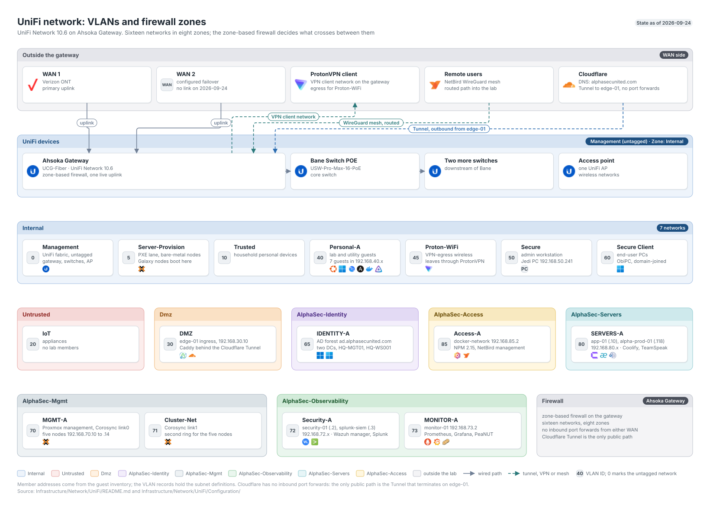

# UniFi Network

**Created:** 2026-07-09  
**Last updated:** 2026-10-15

My network runs on UniFi Network 10.6.106: one gateway, three switches and one access point, with 16 routed VLANs in 12 firewall zones. This folder owns the VLANs, zones, firewall policies, local DNS, VPNs, policy objects and port profiles. Proxmox host firewalls stay with the [Galaxy records](../../Compute/Galaxy/README.md).

## Devices (2026-09-24)

| Device | Model | Firmware | Uplink |
| --- | --- | --- | --- |
| Ahsoka Gateway | Cloud Gateway Fiber (`UCG-Fiber`, controller code UDMA6A8) | 5.1.33.34087 | `Internet 1` WAN |
| Bane Switch POE | Switch Pro Max 16 PoE (`USW-Pro-Max-16-PoE`, code USPM16P) | 7.5.15.17146 | 10 GbE to Ahsoka port 6 |
| Mace Switch | code USWED35 | 2.1.8.971 | 2.5 GbE to Bane port 15 |
| Jango Switch | code USWED35 | 2.1.8.971 | 2.5 GbE to Mace port 4 |
| Anakin AP | code UAPA6A9, 2.4, 5 and 6 GHz | 8.7.11.19419 | Mace port 3 |

All five were online with no upgrade pending. Their management addresses are on Management, `192.168.1.0/24`. `Internet 2` is configured as a DHCP failover WAN but had no link or address.

## Counts

| Object | Count | Verified |
| --- | ---: | --- |
| Networks | 23 (16 corporate LANs, 2 WANs, 1 VPN client, 4 remote-user VPN servers) | 2026-09-24 |
| Firewall zones | 12 (7 built-in, 5 custom) | 2026-09-24 |
| Static DNS records | 30 | 2026-09-24 |
| User-defined firewall policies | 88 (80 allow, 8 block) | 2026-09-26 |
| Network Lists | 22 | 2026-09-16 |
| Client groups | 16 | 2026-09-06 |
| Traffic routes | 1 (`VPN - Proton`) | 2026-09-06 |
| Port profiles | 5 | 2026-09-06 |
| WLANs | 5, 3 enabled | 2026-09-06 |
| Port forwards | 0 | 2026-09-06 |

## Configuration

- [Networks and VLANs](Configuration/network-vlan.md)
- [Firewall zones](Configuration/zone.md)
- [Firewall policies](Configuration/firewall.md)
- [Local DNS](Configuration/local-dns.md)
- [Policy objects: Network Lists, OON policies, traffic routes and client groups](Configuration/objects.md)
- [VPNs and port profiles](Configuration/vpn-networks-port-profiles.md)

## Dynamic DNS and the console name

Dynamic DNS keeps a public name pointed at the gateway when the ISP changes the WAN address: a client on the gateway notices the change and rewrites a Cloudflare DNS record. I reach the console by name at `https://unifi.duresakadi.com`.

| Item | Value |
| --- | --- |
| Console name | `unifi.duresakadi.com`, a DNS-only CNAME to `unifi-ddns.duresakadi.com`. DNS-only means Cloudflare hands out the target's address and does not proxy the traffic |
| Record dynamic DNS maintains | A `unifi-ddns.duresakadi.com`, holding the WAN address |
| Client | UniFi Dynamic DNS with the Cloudflare provider. The gateway runs inadyn 2.13.0 from the generated `/run/ddns-eth0-inadyn.conf` on `eth0` and retries about every two minutes |
| Entry | Hostname `unifi-ddns.duresakadi.com`, username the zone `duresakadi.com`, password the Cloudflare account API token `UniFi DDNS` |
| Token | `UniFi DDNS`: Zone Read and DNS Write on `duresakadi.com` only, no client-IP filter, no expiry. [Cloudflare API tokens](../Cloudflare/README.md#api-tokens) |
| Certificate | Let's Encrypt, from UniFi's built-in certificate manager on this gateway. Its entry, "Unifi Certificate", renews automatically over DNS-01 with the Cloudflare token `UniFi Cert V2`. DNS-01 means it proves it controls the name by writing a TXT record at `_acme-challenge.unifi.duresakadi.com`. The current certificate is valid until 1:51 AM on 2027-01-11 |
| Last verified | 2026-10-15 8:19 AM EDT: the A record matched the current WAN address. The same day, UniFi's Certificates list showed the certificate Active and valid |

> **Before rolling or deleting `UniFi Cert V2`:** create a replacement token first and enter it in the certificate entry through the **Manage** link on UniFi's Certificates list. Renewal is automatic, and the next one is expected around mid-December 2026. If the token stops working before the certificate entry has the replacement, renewal fails silently and the certificate expires at 1:51 AM on 2027-01-11.

Dynamic DNS never updated the record from its setup on 2026-08-13 until I replaced its token on 2026-10-13, and nothing in UniFi showed it. The [incident](../../../Security/Incidents/UniFi/Dynamic%20DNS%20Never%20Updated%20the%20Console%20Name%20-%202026-10-13.md), [troubleshooting record](Documentation/Troubleshooting/Cloudflare%20Rejected%20the%20Dynamic%20DNS%20Token%20Since%20Setup%20-%202026-10-13.md) and [token change](../Cloudflare/Documentation/Change%20Records/UniFi%20DDNS%20Token%20Separation%20-%202026-10-13.md) have the detail. I turned on gateway SSH to read inadyn's configuration and logs for that investigation and turned it off afterwards; on 2026-10-15 port 22 on `192.168.1.1` refused connections.

### Checking that dynamic DNS works

UniFi shows no obvious error when Cloudflare refuses an update, and a record that already holds the right address hides the failure until the address changes. I run these checks after any change to the entry or its token, and after the WAN address changes.

1. **The record matches the WAN address.** The WAN address is the public address the ISP assigns to the gateway's `Internet 1` connection, and UniFi Network shows it for that WAN. `dig` is a command-line DNS lookup tool. Asking `1.1.1.1`, Cloudflare's public resolver, skips the gateway's own cache, which held the old answer for about 270 seconds on 2026-10-13. Run `dig +short unifi-ddns.duresakadi.com @1.1.1.1`; the answer should be the WAN address.
2. **The gateway has written the record.** Cloudflare stamps each DNS record with `modified_on`, the time of its last change, and the Cloudflare API returns it with the record. After setting up dynamic DNS, `modified_on` has to move past the time the record was created. A `modified_on` older than the last WAN address change means the gateway has not reported that change.
3. **The token has been used.** Cloudflare keeps a last-used time for each API token, under Manage account, Account API tokens. A `UniFi DDNS` last-used time older than the last WAN address change means the gateway did not get through. This works only because the token serves one job: on 2026-10-13 the old shared token showed a fresh use by the certificate manager while dynamic DNS was still failing.

## Records

| Date | Record |
| --- | --- |
| 2026-10-13 | [UniFi DDNS Token Separation](../Cloudflare/Documentation/Change%20Records/UniFi%20DDNS%20Token%20Separation%20-%202026-10-13.md) |
| 2026-09-16 | [Policy and DNS Readback](Documentation/Change%20Records/Policy%20and%20DNS%20Readback%20-%202026-09-16.md) |
| 2026-09-09 | [Identity NTP and Client DNS](Documentation/Change%20Records/Identity%20NTP%20and%20Client%20DNS%20-%202026-09-09.md) |
| 2026-09-07 | [Identity Plane Network Preparation](Documentation/Change%20Records/Identity%20Plane%20Network%20Preparation%20-%202026-09-07.md) |
| 2026-09-06 | [Empty IOT Client Group Removal](Documentation/Change%20Records/Empty%20IOT%20Client%20Group%20Removal%20-%202026-09-06.md) |
| 2026-09-02 | [Monitoring Ports for What's Up Docker and the Alert Bot](Documentation/Change%20Records/Monitoring%20Ports%20for%20What's%20Up%20Docker%20and%20the%20Alert%20Bot%20-%202026-09-02.md) |
| 2026-08-31 | [Detection Mode to Notify and Block](Documentation/Change%20Records/Detection%20Mode%20to%20Notify%20and%20Block%20-%202026-08-31.md) |
| 2026-08-30 | [DMZ Added to Threat Management](Documentation/Change%20Records/DMZ%20Added%20to%20Threat%20Management%20-%202026-08-30.md) |
| 2026-08-29 | [DMZ-A VLAN 90 Removal](Documentation/Change%20Records/DMZ-A%20VLAN%2090%20Removal%20-%202026-08-29.md) |
| 2026-08-13 | [ubuntu-dev Workstation Access](Documentation/Change%20Records/ubuntu-dev%20Workstation%20Access%20-%202026-08-13.md) |
| 2026-08-10 | [Proton-WiFi VLAN 45](Documentation/Change%20Records/Proton-WiFi%20VLAN%2045%20-%202026-08-10.md) |
| 2026-08-08 | [VPN Management Access to DMZ](Documentation/Change%20Records/VPN%20Management%20Access%20to%20DMZ%20-%202026-08-08.md) |
| 2026-08-07 | [edge-01 Move to DMZ VLAN 30](Documentation/Change%20Records/edge-01%20Move%20to%20DMZ%20VLAN%2030%20-%202026-08-07.md) |
| 2026-07-27 | [Zone and Object Consolidation](Documentation/Change%20Records/Zone%20and%20Object%20Consolidation%20-%202026-07-27.md) |
| 2026-07-27 | [MGMT-A Final Lockdown](Documentation/Change%20Records/MGMT-A%20Final%20Lockdown%20-%202026-07-27.md) |
| 2026-07-27 | [UniFi Firewall Audit](../../../Security/Assessments/UniFi%20Firewall%20Audit%20-%202026-07-27.md) |
| 2026-07-12 | [Security-A Migration](Documentation/Change%20Records/Security-A%20Migration%20-%202026-07-12.md) |

Policy changes made for a platform are recorded with that platform and listed in the [firewall view's records table](Configuration/firewall.md#records). The [troubleshooting index](Documentation/Troubleshooting/README.md) holds four dated issues. The retired Kasm lab network is in the [archive](../../../Archive/Infrastructure/Network/UniFi/Documentation/Change%20Records/Kasm%20Lab%20Network%20Simplification%20-%202026-07-23.md).

The gateway, Bane Switch POE and the Verizon ONT run on `UPS-02`, an APC Back-UPS RS 1500MS2. [Power equipment](../../Hardware/Power.md).
